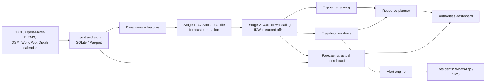

# NIRVAYU

**Predict. Prioritize. Prove.**
Ward-level Diwali smog forecasting and resource prioritisation. Validated on Delhi, built to port to any city.

> **Status:** hackathon prototype. The decision layer (exposure ranking, trap-hour windows, resource planner, alerts, evaluation metrics) is implemented and tested. Real-data ingestion and model training are in progress. The dashboard currently runs on clearly labelled **synthetic demo data**. Result numbers below are filled in only after the held-out backtest is run.

## The problem
Delhi's forecasts are citywide, but Diwali smoke is hyperlocal. Authorities respond with blanket measures and spread limited teams by guesswork. NIRVAYU tells them **which wards will trap smoke, when, and where to send teams first**, then scores its own forecasts against reality.

## What it does
- **Ward risk forecast** with q10/q50/q90 ranges and a confidence flag per ward.
- **Trap-hour windows**: the hours a ward is forecast to stay above a safety threshold.
- **Exposure ranking**: PM2.5 x people at risk (population plus schools and hospitals), not pollution alone.
- **Resource planner**: compares targeted deployment against equal spread, scored on actual outcomes.
- **Threshold alerts** for affected wards only (WhatsApp/SMS hook).
- **Forecast-vs-actual scoreboard** so the system is accountable.

## Architecture

Full diagrams and design decisions: [docs/architecture.md](docs/architecture.md).

## Repo layout
```
config/delhi.yaml          city config (swap this to port to another city)
src/nirvayu/
  data/ingest.py           CPCB, Open-Meteo, FIRMS loaders; ward static features (TODO)
  features.py              Diwali phase, cracker window, wind stagnation
  model/station_forecast.py  Stage 1 quantile XGBoost
  model/downscale.py       Stage 2 IDW x learned ward offset + confidence
  exposure.py              exposure score, CPCB bands, ward ranking
  planner.py               targeted vs equal-spread simulation, deployment list
  alerts.py                trap-hour windows, alert messages, dispatch hook
  evaluate.py              LOSO, top-k hit rate, band accuracy, interval coverage
  demo_data.py             SYNTHETIC data for the demo
app/streamlit_app.py       dashboard
scripts/run_pipeline.py    CLI entry point
tests/                     unit tests for the decision layer
```

## Quickstart
```bash
pip install -r requirements.txt
make test                         # unit tests
python scripts/run_pipeline.py --demo   # decision layer on synthetic data
make demo                         # Streamlit dashboard
```

## Data setup (real run)
1. Download station PM2.5 history from the CPCB/DPCC portal into `data/raw/` and adjust the column map in `data/ingest.py`.
2. Add Delhi ward boundaries as `data/raw/delhi_wards.geojson` and station coordinates as `data/raw/cpcb_stations.csv`.
3. Get a free NASA FIRMS `MAP_KEY` and export it as `FIRMS_MAP_KEY`.
4. `pip install -r requirements-geo.txt` for OSM and WorldPop processing.

## Method
1. **Stage 1:** quantile XGBoost forecasts PM2.5 at each station, using lags, weather, fire counts and Diwali features (hours from Diwali night, cracker-hour flag, wind stagnation).
2. **Stage 2:** station forecasts are spread to wards by inverse-distance weighting, scaled by an offset learned from static layers (roads, markets, industry, green cover). Distance to the nearest station drives the confidence flag.
3. **Decision layer:** exposure = PM2.5 x (population + sensitive sites x people-equivalent). The people-equivalent per site is an assumption set in `config/delhi.yaml`.

## Evaluation protocol
We judge decisions, not just RMSE.

| Metric | What it shows | Result |
|---|---|---|
| Leave-one-station-out MAE | Whether ward-level claims hold where we have no sensor | _TBD after backtest_ |
| Top-10 hit rate | Of 10 flagged wards, how many were truly worst | _TBD_ |
| MAE vs persistence baseline | Lift over "tomorrow equals today" | _TBD_ |
| Interval coverage (q10 to q90) | Whether the ranges are honest | _TBD_ |
| Planner coverage: targeted vs equal spread | Resource-saving claim, scored on actual exposure | _TBD_ |

Split: train on 2018-2024, test on the full 2025 Diwali period, never touched during training. Diwali gives few events, so small-sample caveats apply.

## Limitations
- Delhi has a limited number of stations, so ward values are estimates with ranges, not measurements.
- Ward ranking is the claim, not exact street-level PM2.5.
- Exposure weights are assumptions and should be tuned with local authorities.
- Validated on Delhi only.

## Porting to another city
Add `config/<city>.yaml`, a ward boundary file and that city's station list. Candidates: Lucknow, Kanpur, Patna, Kolkata, Mumbai.

## Roadmap
- [x] Decision layer, evaluation metrics, tests, demo dashboard
- [ ] Real data ingestion and ward static features
- [ ] Trained station model and held-out backtest
- [ ] Live scoreboard on real observations
- [ ] WhatsApp/SMS provider integration

## License
MIT
